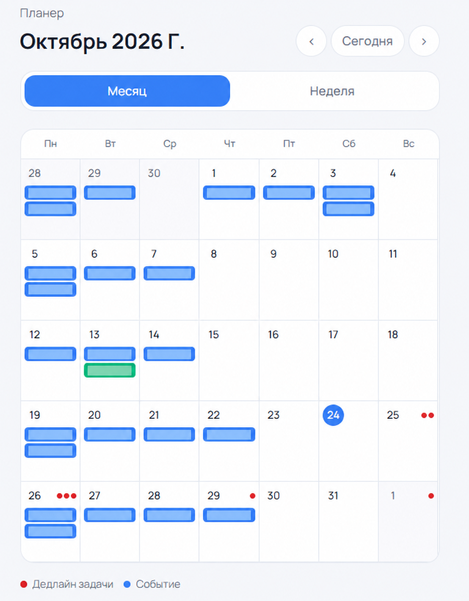
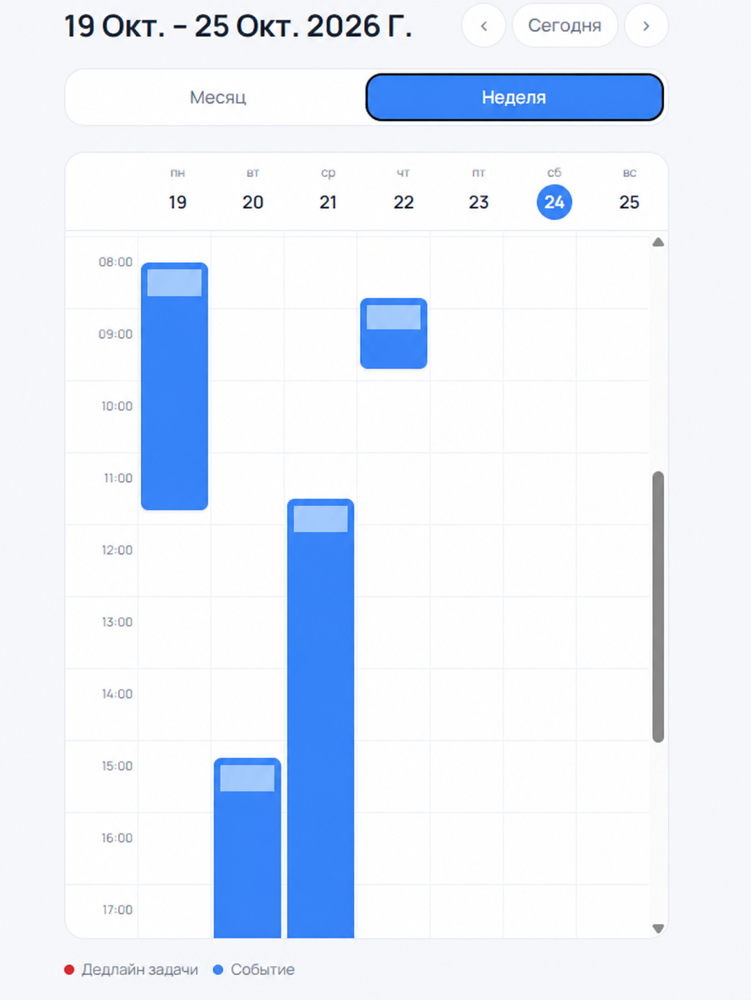
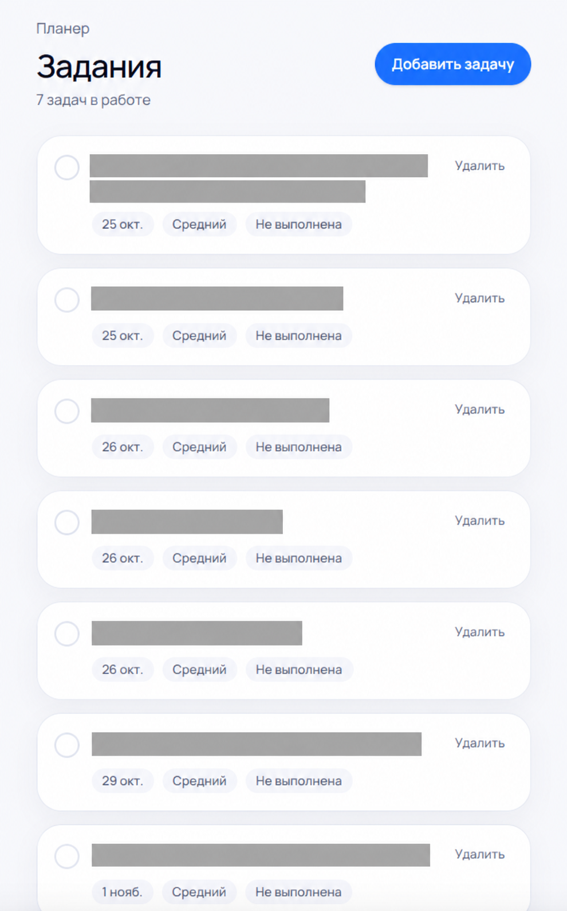
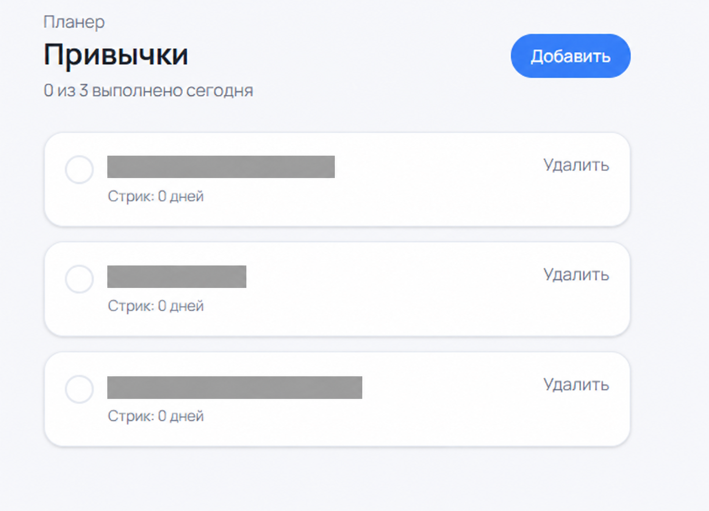
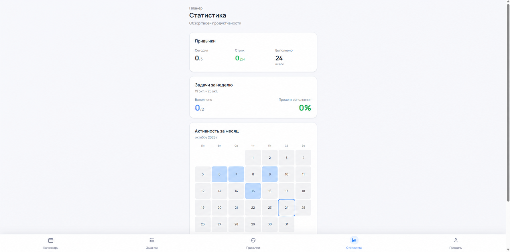
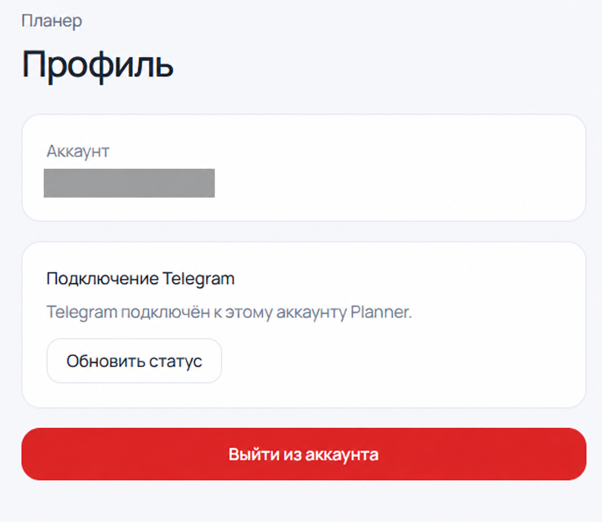

[English](README.md) | **Русский**

# Planner

**Задачи, календарь, привычки и статистика продуктивности в одном приложении.**

[Открыть приложение](https://planner-app-six-woad.vercel.app) · [Telegram-ассистент](https://github.com/selecteg12/planner-ai-assistant)

Planner — личный планировщик на Next.js, React и Supabase. Он объединяет повседневные задачи, недельный обзор и отслеживание привычек. Интерфейс на русском языке.

Telegram-ассистент работает с тем же аккаунтом Supabase и позволяет управлять планами обычными сообщениями.

## Скриншоты

Снимки сделаны в русскоязычной версии. Личные записи и данные аккаунта скрыты. Основная навигация видна на скриншоте статистики.

### Календарь

<p>
  
  
</p>

### Задачи и привычки

<p>
  
  
</p>

### Статистика и навигация



### Профиль и привязка Telegram



## Возможности

| Раздел | Что можно сделать |
| --- | --- |
| Задачи | Создать задачу с заметкой, сроком и низким, средним или высоким приоритетом; завершить, вернуть в работу или удалить. Открытые задачи показываются перед завершёнными, просроченные — выше остальных. |
| Календарь | Просмотр месяца и недели; создание, изменение и удаление событий; цвета; ежедневные, еженедельные, ежемесячные и ежегодные повторы с датой окончания. Сроки открытых задач тоже видны в календаре. |
| Привычки | Создать или удалить привычку, отметить выполнение за сегодня или отменить его, следить за текущей серией. Отметки хранятся по датам. |
| Статистика | Выполнение задач за неделю, прогресс привычек за сегодня, текущие серии и месячная карта выполненных задач. |
| Аккаунт | Регистрация и вход по email и паролю, профиль, выход, привязка Telegram одноразовым кодом с коротким сроком действия. |

### Расчёт статистики

- **Выполнение задач за неделю:** завершённые задачи делятся на все задачи со сроком в текущей неделе, с понедельника по воскресенье. Задачи без срока не учитываются; для пустой недели показывается 0%.
- **Месячная карта:** выполненные задачи группируются по дате `completed_at` в текущем месяце.
- **Серия привычки:** последовательные даты выполнения отсчитываются назад от сегодня либо от вчера, если сегодняшняя отметка ещё не поставлена.

## Telegram-ассистент

Ассистент находится в [отдельном репозитории](https://github.com/selecteg12/planner-ai-assistant). Он читает планы, создаёт и изменяет задачи и события, отмечает привычки, работает с идеями и напоминаниями.

Чтобы связать аккаунт:

1. Войдите в Planner и откройте **Профиль**.
2. Создайте код подключения. Он действует 10 минут.
3. Откройте настроенного бота, отправьте `/start` и введите код.

Браузер передаёт в Supabase RPC только SHA-256 хеш кода. Серверный ассистент погашает код и связывает Telegram-аккаунт с пользователем Planner. Перед удалением задачи, события или идеи бот запрашивает отдельное подтверждение.

Данные доступа бота, настройки LLM, расписание, дополнительные таблицы и SQL привязки описаны в [инструкции ассистента](https://github.com/selecteg12/planner-ai-assistant#run-locally). Запуск веб-приложения сам по себе не развёртывает бота.

## Стек

| Уровень | Технологии |
| --- | --- |
| Интерфейс | Next.js App Router, React, JavaScript, Tailwind CSS |
| Данные и вход | Supabase, PostgreSQL, Supabase Auth |
| Контроль доступа | Запросы авторизованного пользователя и политики PostgreSQL Row Level Security |
| Хостинг | Vercel |
| Интеграция | Telegram-ассистент на Node.js, Telegraf, вызовы инструментов через LLM и Supabase |

## Архитектура и данные

Браузер использует JavaScript-клиент Supabase для входа и операций планировщика. Веб-приложение и отдельно развёрнутый Telegram-ассистент работают с общими записями.

| Сущность | Содержимое |
| --- | --- |
| `tasks` | Название, заметки, сроки, приоритет, состояние и время завершения |
| `events` | Данные события, начало и окончание, цвет, настройки повторов |
| `habits` | Привычки пользователя |
| `habit_completions` | Выполнение привычек по датам |
| Таблицы и RPC привязки Telegram | Одноразовые коды и связи аккаунтов; настраиваются в проекте ассистента |

Записи связаны с `user_id`. В базе должны быть включены и настроены RLS-политики, ограничивающие чтение и запись владельцем. Фильтрация в браузере и проверка входа в интерфейсе не заменяют контроль доступа к базе.

Репозиторий содержит веб-приложение. Полного набора миграций и автоматического создания схемы базы пока нет.

## Локальный запуск

Нужны версия Node.js, совместимая с Next.js 16, npm и существующий проект Supabase со схемой Planner и политиками доступа. Для разработки подходит Node.js 22 LTS.

1. Клонируйте репозиторий и установите закреплённые зависимости:

   ```bash
   git clone https://github.com/selecteg12/planner-app.git
   cd planner-app
   npm ci
   ```

2. Создайте `.env.local` в корне:

   ```dotenv
   NEXT_PUBLIC_SUPABASE_URL=your_supabase_project_url
   NEXT_PUBLIC_SUPABASE_ANON_KEY=your_supabase_anon_key
   ```

   Эти значения нужны браузерному клиенту. Ключи service-role, токены бота и ключи LLM нельзя помещать в браузерные переменные и файлы Git.

3. Настройте таблицы, политики владения и Supabase Auth. Для привязки Telegram примените соответствующий [SQL ассистента](https://github.com/selecteg12/planner-ai-assistant/tree/main/schema-proposals) к тому же проекту.

4. Запустите сервер разработки:

   ```bash
   npm run dev
   ```

   Откройте [localhost:3000](http://localhost:3000).

### Команды

| Команда | Назначение |
| --- | --- |
| `npm run dev` | Сервер разработки |
| `npm run lint` | Проверка ESLint |
| `npm run build` | Производственная сборка |
| `npm start` | Локальный запуск производственной сборки |

## Структура проекта

| Путь | Назначение |
| --- | --- |
| `app/calendar/`, `components/CalendarView.jsx` | Календарь и повторяющиеся события |
| `app/tasks/`, `components/TasksView.jsx` | Задачи и сортировка |
| `app/habits/` | Привычки и ежедневные отметки |
| `app/stats/` | Недельные показатели и карта активности |
| `app/profile/` | Профиль, выход и привязка Telegram |
| `app/login/`, `app/signup/` | Экраны входа и регистрации |
| `components/AuthGuard.jsx` | Проверка входа в интерфейсе |
| `components/BottomNav.jsx` | Основная навигация |
| `lib/supabase.js` | Браузерный клиент Supabase |
| `app/globals.css` | Общие стили |

## Развёртывание

Импортируйте репозиторий в Vercel и задайте две переменные `NEXT_PUBLIC_SUPABASE_*` для нужного окружения. Настройте URL в Supabase Auth и проверьте наличие схемы и RLS-политик в подключённой базе.

Telegram-ассистент развёртывается отдельно и подключается к тому же Supabase. Его серверные секреты хранятся в окружении ассистента.

## Дальнейшая работа

- Добавить версионируемые миграции и инструкцию настройки нового проекта Supabase.
- Добавить браузерные проверки входа, повторов событий, привычек и статистики.
- Улучшить мобильные взаимодействия и сообщения об ошибках операций.
- Исследовать push-уведомления и более подробное планирование дня.
